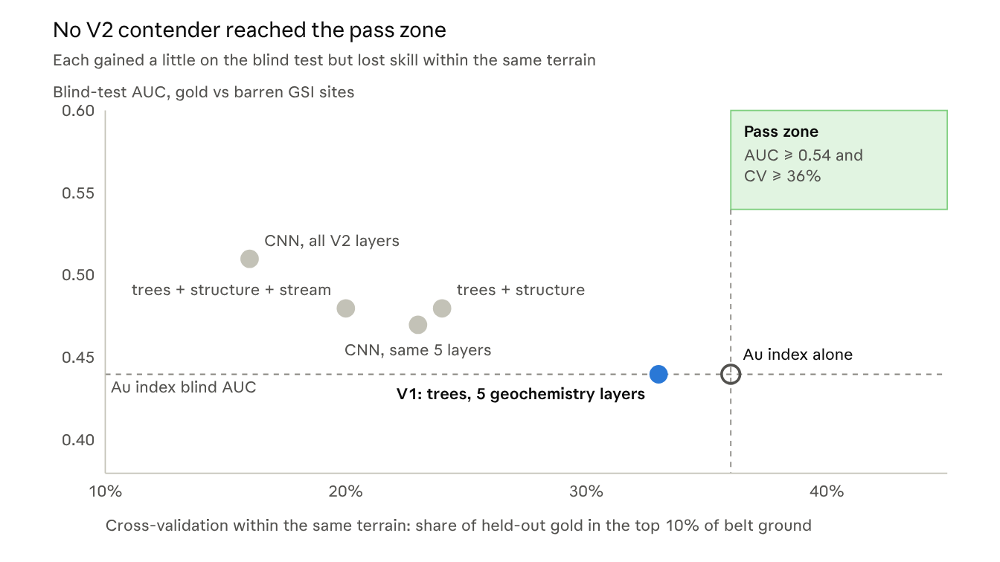

# ai-mineral-targeting

A gold prospectivity pipeline for a block of the Dharwar craton in Karnataka and Andhra Pradesh, India
(76.0–77.75°E, 13.75–15.75°N), built on the data of the IndiaAI–GSI Hackathon on Mineral Targeting 2025.
It turns public geoscience data into a ranked map and a shortlist of prospects, then tests the result
honestly: against terrain bias, and blind against Geological Survey of India (GSI) exploration results,
gold and barren alike, that the model never saw.

**Status: parked (November 2026).** V1 is a working belt-scale screening map. V2 tested finer structure,
more geochemistry and a CNN against a pass bar fixed before the runs; nothing passed. Full write-up:
[docs/RESULTS.md](docs/RESULTS.md).

## Results in brief

- **Belt-scale skill is real.** V1 puts 90% of held-out known gold in its top 10% of the map (greenstone
  alone: 73%). Compared only with ground of the same relief and land cover, it catches 33% in the top 10%
  of belt ground, against 10% for random and 36% for the Au pathfinder index on its own.
- **The model that looked best was learning terrain.** A 21-feature model (geochemistry, radiometrics,
  gravity, magnetics) scored 30% of gold in its top 1% on standard cross-validation; every
  terrain-controlled check rejected it.
- **Blind test against 469 GSI exploration sites** parsed from 16 GSI reports (4,762 gold assays): V1
  scores AUC 0.60 and 0.67 on held-out folds, the same as the Au index. No map tells a gold follow-up from
  a barren one.
- **V2 failed the pass bar.** Shear zones, stream geochemistry and a CNN each gained 0.03–0.07 AUC on the
  blind test but lost skill within the same terrain. On the same inputs, the CNN was no better than the
  trees.
- **Lesson:** with regional data (geochemistry sampled every 1–4 km, exploration-biased mapping and
  labels), the ceiling is set by the data, not the algorithm.



## Pipeline

All scripts sit in the repository root and run from it. Each one documents its inputs, outputs and
options at the top of the file.

| Stage | Scripts |
| --- | --- |
| Data register and labels | `inventory.py`, `prepare_vectors.py` |
| Input layers on a 100 m grid (UTM 43N) | `build_raster_stack.py`, `build_vector_features.py`, `litho_classes.py`, `build_geochem_grid.py`, `build_terrain_layers.py` |
| NGDR data (API and map service) | `ngdr_pull.py`, `ngdr_wfs_pull.py` |
| Model and cross-validation | `train_v1.py` (gradient-boosted trees, bagged; `--learner cnn` uses `cnn_learner.py`), `compare_runs.py`, `terrain_bias_check.py` |
| Targets and shortlist | `make_targets.py`, `shortlist_targets.py` |
| Automated desk check (satellite imagery, OpenStreetMap) | `prepare_step4.py`, `auto_desk_check.py` |
| GSI exploration results | `gsi_reports.py` (which reports to fetch), `gsi_labels.py` (tables, GIS files and text to graded sites), `gsi_eval.py` (blind test with cluster bootstrap) |
| V2 | `build_v2_layers.py` (shear zones, soil and stream geochemistry), `v2_verdict.py` (applies the pass bar) |
| Summary | `v1_summary.py` |

`run_pipeline.bat` runs the stages in order on Windows: `run_pipeline.bat` for inputs and V1, then
`run_pipeline.bat gsi` once the GSI reports are downloaded, for the blind test and V2.

## Validation design

- **Leave-one-region-out cross-validation:** labels are split into 5 spatial regions; each is held out in
  turn.
- **Terrain control:** known gold sits on hillier, scrubbier ground than the belt as a whole, so each
  held-out label is also compared only with ground of the same relief and land cover.
- **Blind test with negatives:** GSI trench, rock, channel and drill results are graded into gold,
  anomalous and barren sites. None is used in training.
- **Cluster bootstrap:** GSI sites cluster in a few blocks, so uncertainty comes from resampling whole
  clusters, not single sites.
- **Pass bar fixed before the runs:** a new model counts only if it beats the Au index on the blind test by
  at least 0.10 AUC, in at least 90% of resamples, without losing skill within the same terrain.

## Setup

```
conda env create -f environment.yml
conda activate ai-mineral-targeting
```

PyTorch is needed only for the CNN contender. On Windows, use the conda-forge build already listed in
`environment.yml`; the pip build can fail to load inside a conda environment.

## Data

No data are included. To run the pipeline you need:

- the IndiaAI–GSI Hackathon on Mineral Targeting 2025 dataset, extracted to `data/raw/aikosh-gsi-ka-ap/`;
- an account on GSI's National Geoscience Data Repository (NGDR), for the API and for downloading GSI
  exploration reports by hand into `Reports/<report_id>/` (`gsi_reports.py fetchlist` lists which ones);
- internet access for the open layers fetched on the way (Copernicus DEM, ESA WorldCover, the NGDR map
  service, Sentinel-2 imagery and OpenStreetMap for the desk check).

Use each source under its own terms. Prospect locations from this work are not published.

## Copyright

Copyright © 2026 Tushar Goel. All rights reserved.

This repository is public so the code can be read. No licence is granted: you may not copy, modify or
redistribute it without written permission.
