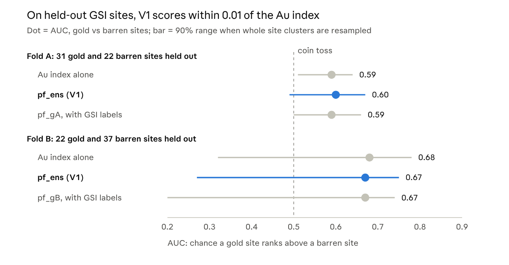
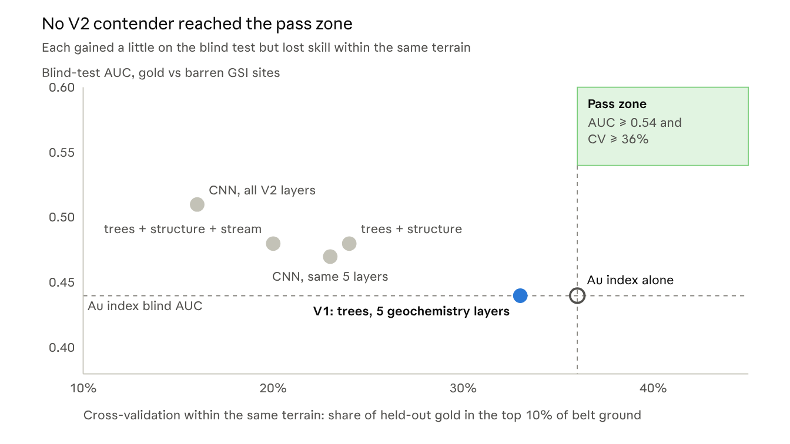

# Results: V1 model and V2 test

As of 16 November 2026. Prospect locations are not published.

## Summary

V1 is a geochemistry-only model that finds prospective gold belts well but cannot yet pick which target
inside a belt carries gold. No map tested could, including the Au pathfinder index and GSI's own follow-up
choices.

- **Belt-scale skill is real.** V1 puts 90% of held-out known gold in its top 10% of the map (greenstone
  alone: 73%). Within the same terrain it catches 33% in the top 10% of belt ground, against 10% for random.
- **The model that looked best was learning terrain.** The 21-feature model scored 30% of gold in its top
  1%, but every terrain-controlled check rejected it.
- **Blind test on GSI exploration results:** AUC 0.60 and 0.67 on the two held-out folds, the same as the Au
  index alone. Adding GSI sites to training added nothing, so V1 keeps them out and they stay an
  independent test.
- **23 prospects** (16 tier A, 7 tier B) survived the automated desk check. GSI sampling reaches five of
  them: one hit, one miss at the peak, three inconclusive.
- **V2 failed the pass bar fixed before the runs.** Shear zones, more geochemistry and a CNN each gained a
  little on the blind test and lost skill within the same terrain.

The method holds up: honest testing caught a bias that ordinary cross-validation would have shipped, and a
pass bar fixed in advance stopped open-ended tuning. The ceiling is set by the data (regional sampling,
exploration-biased mapping and labels), not by the algorithm.

## Data and labels

V1 trains on 82 known gold labels and is tested against 469 GSI exploration sites it never saw.

- **Area and grid:** 76.0–77.75°E and 13.75–15.75°N on a 100 m grid (UTM 43N, 1,903 × 2,230 cells). Models
  rank only belt ground: cells within 1 km of mapped greenstone, 23.8% of the 3.64 million cells in the
  model mask.
- **Inputs available:** geochemistry, radiometrics, gravity, magnetics, lithology and terrain layers. V1
  uses five geochemistry layers only: the Au pathfinder index, Au, As, Sb and Bi, each constrained so that
  higher values can only raise prospectivity.
- **Training labels:** 48 gold occurrences (weight 1) and 34 old workings (weight 0.25); 77 label cells
  fall on belt ground.
- **GSI evidence:** 16 GSI reports read from NGDR (tables, GIS files and text): 4,762 gold results, 1,402
  with positions. Results within 250 m were merged into sites and graded:

| GSI site class | Rule | Sites |
| --- | --- | --- |
| Positive | a rock, channel, trench, pit, drill or underground sample ≥ 0.5 g/t | 27 |
| Anomalous | best rock sample 0.1–0.5 g/t, or soil / stream ≥ 100 ppb | 35 |
| Barren (strong) | ≥ 3 trench, pit, drill or channel samples, all < 0.1 g/t | 15 |
| Barren | ≥ 3 rock samples, all < 0.1 g/t | 47 |
| Barren (weak) | soil or stream samples only, all < 50 ppb | 180 |
| Too few samples | none of the above | 165 |

## How the model was chosen

The decision rule, fixed before the final runs: V1 is the simplest map that is not beaten on the two
terrain-controlled checks, cross-validation within the same terrain and the blind test on GSI sites.

| Model | Inputs | Top 1% of map | Within same terrain, top 10% | Within greenstone, top 10% | Range over 8 background draws | Blind test AUC, all GSI sites |
| --- | --- | --- | --- | --- | --- | --- |
| pg_ens | 21: geochemistry, radiometrics, gravity, magnetics | 30% | 29% | 42% | 15–65% | 0.27 |
| pg_rc | as pg_ens, radiometrics corrected for terrain | 12% | 14% | 19% | 15–27% | 0.32 |
| **pf_ens (V1)** | 5: Au index, Au, As, Sb, Bi | 22% | 33% | 34% | 25–33% | 0.44 |
| pf_v1 | as pf_ens, plus 26 GSI gold and 59 barren sites | 19% | 31% | 33% | 27–36% | (trained on them) |
| Au pathfinder index | no training | 22% (with greenstone) | 36% | 28% | – | 0.44 |

Cross-validation leaves out one of 5 regions at a time and scores the 77 original labels in it; random
scores 1% and 10%.

- **pg_ens was rejected.** It wins only on the top 1%, the number terrain inflates: known gold sits on hilly,
  scrubby ground (median relief 29 m against 11 m for belt ground).
- **The radiometrics carried the bias.** Terrain explains only 4–8% of the radiometric data, yet removing
  that share cut within-terrain capture from 29% to 14%.
- **GSI labels did not help** on GSI clusters held out of training, so they are kept out of V1.

## Blind test against GSI exploration results

On GSI sites held out of training, V1 scores the same as the Au index alone.

GSI gold and barren sites were grouped into clusters (sites within 5 km of each other) and split into two
folds; each pf_g model was trained without one fold and tested on it. pf_ens and the index never saw any GSI
site.

On all GSI sites at once, every map falls below a coin toss (pf_ens and the Au index 0.44, pg_ens 0.27).
One area drives that: a cluster where about 25 gold sites share ground with about 40 barren sites from
other reports, and every map ranks the barren ground higher. GSI probably chose that barren ground from the
same geochemical anomalies the maps use. The maps agree with where GSI chose to explore, but none tells a
gold follow-up from a barren one; about half of GSI's own tested sites came back barren.

## V1 prospects

23 prospects survived the automated desk check (satellite imagery and OpenStreetMap): 16 tier A, 7 tier B.
GSI sampling reaches five of them: one has gold confirmed within 1 km of its peak, one was sampled at its
peak and found barren, and three are inconclusive (gold or barren ground 2–3 km away). The other 18 are
untested by the GSI reports read so far. Only 2 of 32 prospects from the earlier, terrain-biased model have
a V1 prospect within 2 km: removing the bias moved almost the whole shortlist.

## V2 result

V2 failed the pass bar: no contender beat the Au index on the blind test by 0.10 while keeping its skill
within the same terrain. Training labels stayed the same 82, so only inputs or the algorithm changed.

- **Every V2 model traded one test for the other.** Shear zones, stream geochemistry and the CNN raised the
  blind-test AUC by 0.03–0.07, but within-terrain capture fell from 33% to 16–24%.
- **The algorithm is not the gap.** On V1's five layers the CNN was ahead of the trees in 96% of resamples,
  but by only 0.03 AUC, and it caught 23% of gold within the same terrain against 33%.
- **Shear zones carry mapping bias.** Known gold sits closer to mapped shears than 95% of ground, yet adding
  them cut within-terrain skill: detailed shear mapping exists mainly where exploration already happened.
- **The 3.5 km belt did worse,** at AUC 0.42 against 0.46 for the index on that ground.
- **Data gaps.** The NGDR soil layer is unusable as delivered (85% of its non-zero values are a 555
  placeholder). Stream-sediment Au was left out by a strict layer check, because 64% of its values sit at
  one level, so V2 used stream As, Sb and Bi only.

## Known limits

- **Inside a belt it cannot pick the winner.** Inputs are regional: stream-sediment geochemistry sampled
  every 1–4 km, while gold sits in shear zones tens to hundreds of metres wide.
- **It does not look off the belts.** The richest new gold in the reports (15.1 and 13.6 g/t) sits 2.8–3.1
  km from mapped greenstone, at a granite contact.
- **The labels favour exposed ground.** The terrain checks guard against that, but the bias remains.
- **The blind test is thin.** GSI sites cluster in a handful of blocks; differences under about 0.1 AUC are
  noise.
